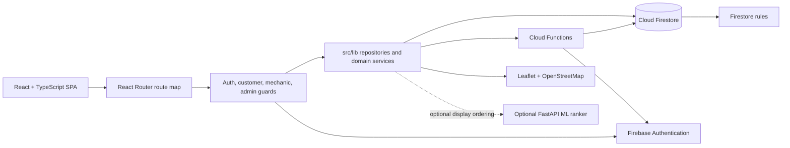
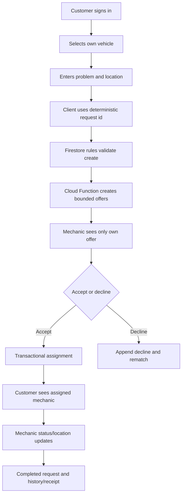
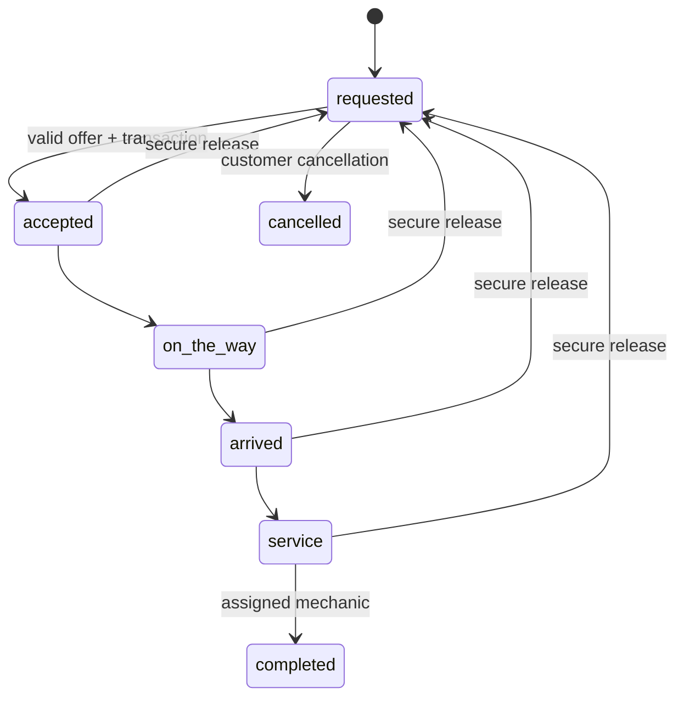
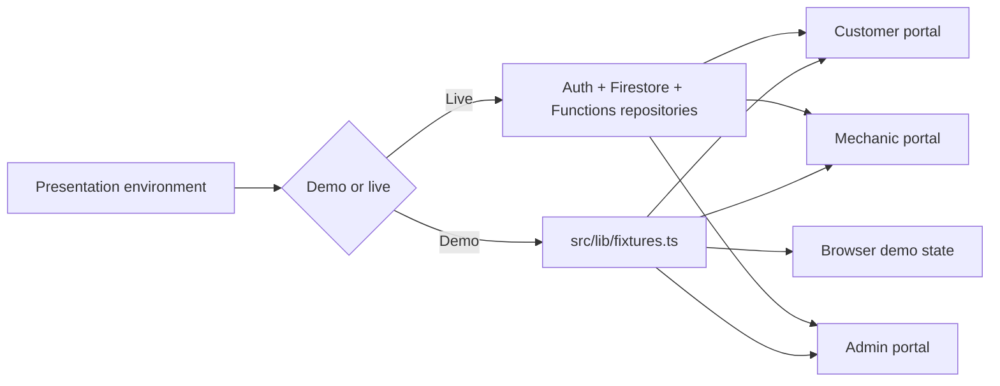
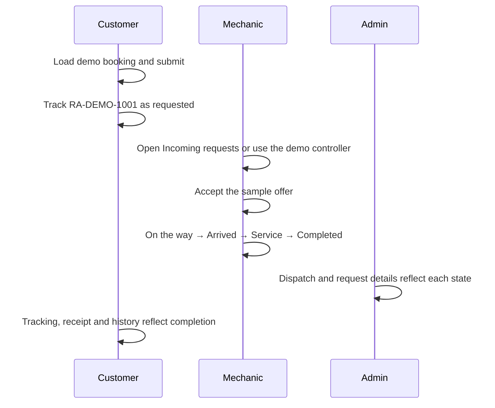

# RoadAssist architecture, routes and workflows

This document describes the current implementation in `D:\RoadAssist`. It is intentionally evidence-based: code presence is distinguished from emulator, unit, build and browser verification. No credentials or private records are included.

## 1. System architecture

RoadAssist is a Vite React/TypeScript single-page application backed by Firebase Authentication, Firestore security rules, callable/triggered Cloud Functions, Leaflet/OpenStreetMap rendering, and an optional FastAPI/ML ranking service.



Frontend bootstrap is `src/main.tsx` → `src/App.tsx` → `src/routes.tsx`. `AuthProvider` subscribes to Firebase Auth and the layouts provide the public, authentication, customer, mechanic and admin shells. `RequireAuth` checks a signed-in user; `RequireCustomer` prevents customer routes being used as another portal. Admin operations additionally use the Firebase custom claim checked by `RequireAdmin` and by Firestore rules.

The `src/lib` layer contains Firebase initialization, auth/profile helpers, customer and mechanic repositories, dispatch calls, admin feeds, geolocation, map helpers, validation, notifications, analytics and the deterministic mechanic guide. `functions/src` is the trusted boundary for approval, dispatch, offer lifecycle, notifications, projections and durable audit events. `firestore.rules` is a second, client-write boundary; Cloud Functions use Admin SDK and therefore bypass client rules by design.

The map layer provides map tiles, customer/mechanic markers, live-location freshness and straight-line display where available. It does not currently provide a road-routing provider or traffic-aware ETA. The ML service exists at `ml/api/main.py` with a saved model and tests; `src/lib/mlRank.ts` treats it as optional display ordering and dispatch remains deterministic/server-authoritative.

## 2. Route catalogue

All entries in `src/routes.tsx` point to a real page component; `PlaceholderPage` is not registered. “Implemented” means the page has a real component and source-level data/action wiring. Browser rendering with authenticated live data still requires a configured local Firebase session.

### Public and authentication routes

| URL | Component | Access | Purpose / data / actions | Status |
|---|---|---|---|---|
| `/` | `LandingPage` | Public | Product entry point and portal links | Implemented |
| `/features` | `FeaturesPage` | Public | Supported product capabilities | Implemented |
| `/pricing` | `PricingPage` | Public | Catalogue service descriptions; not an authoritative bill | Implemented |
| `/about` | `AboutPage` | Public | Product and network explanation | Implemented |
| `/contact` | `ContactPage` | Public | Contact form/operations guidance | Implemented |
| `/onboarding` | `OnboardingPage` | Public | Explains request-to-recovery journey | Implemented |
| `/login` | `LoginPage` | Public | Generic Firebase email/password entry | Implemented |
| `/signup` | `SignupPage` | Public | Customer-safe signup and profile creation | Implemented |
| `/customer/login` | `LoginPage` | Public | Customer-labelled sign-in entry | Implemented |
| `/customer/signup` | `SignupPage` | Public | Customer-labelled signup entry | Implemented |
| `/mechanic/login` | `LoginPage` | Public | Mechanic sign-in entry | Implemented |
| `/mechanic/signup` | `SignupPage` | Public | Mechanic account hint plus approval onboarding | Implemented |
| `/admin/login` | `LoginPage` | Public | Claim-gated admin sign-in entry | Implemented |
| `/admin/signup` | `AdminSignupPage` | Public | Invitation-only admin enrollment explanation; no self-escalation | Implemented |
| `/forgot` | `ForgotPage` | Public | Password reset email | Implemented |
| `/verify` | `VerifyPage` | Signed in | Email verification state and resend | Implemented |

### Customer routes

| URL | Component | Guard | Data and actions | Status |
|---|---|---|---|---|
| `/app` | `CustomerDashboard` | Auth + customer | Own requests, active request, vehicles and history; demo-labelled preview only when the live feed is empty/unavailable | Implemented; live browser not verified |
| `/services` | `ServicesPage` | Auth + customer | Service catalogue and navigation to request creation | Implemented |
| `/guide` | `MechanicGuidePage` | Auth + customer | Predefined Demo Mechanic Bot, safety triage, existing availability feed and explicit confirmation before `createRequest` | Implemented; deterministic, not AI |
| `/request` | `RequestPage` | Auth + customer | Own vehicle, problem, coordinates, optional mechanic and backend request creation | Implemented |
| `/request/:id` | `RequestAliasPage` | Auth + customer | Compatibility entry to request flow | Implemented |
| `/mechanics` | `MechanicDirectoryPage` | Auth + customer | Public approved mechanic projection and filters | Implemented |
| `/mechanic/:id` | `MechanicDetailPage` | Auth + customer | Public mechanic profile projection | Implemented |
| `/map` | `CoverageMapPage` | Auth + customer | Coverage map and location-aware request entry | Implemented; routing not included |
| `/track` | `TrackingPage` | Auth + customer | Select/track own active request and assigned mechanic | Implemented; live browser not verified |
| `/track/:id` | `TrackingPage` | Auth + customer | Track one authorized request | Implemented; live browser not verified |
| `/history` | `HistoryPage` | Auth + customer | Own completed/cancelled service records | Implemented |
| `/history/:id` | `HistoryDetailPage` | Auth + customer | Own receipt, rating and request detail | Implemented |
| `/vehicles` | `VehiclesPage` | Auth + customer | Own vehicle create/edit/delete and validation | Implemented |
| `/emergency` | `EmergencyPage` | Auth + customer | Safety and emergency guidance | Implemented |
| `/notifications` | `NotificationsPage` | Auth + customer | Own server-created inbox and read state | Implemented |
| `/profile` | `ProfilePage` | Auth + customer | Own Firestore profile fields | Implemented |
| `/settings` | `SettingsPage` | Auth + customer | Local/backend status and account controls | Implemented |

### Mechanic routes

| URL | Component | Guard | Data and actions | Status |
|---|---|---|---|---|
| `/m` | `MechanicDashboardPage` | Auth + mechanic | Approval, availability, offers, active job, history and earnings; preview fallback is labelled | Implemented; live browser not verified |
| `/m/requests` | `MechanicRequestsPage` | Auth + mechanic | Own offers, secure accept/decline operations | Implemented |
| `/m/job` | `MechanicJobPage` | Auth + mechanic | Current assigned job and valid next transition | Implemented |
| `/m/job/:id` | `MechanicJobPage` | Auth + mechanic | One assigned job, location and completion | Implemented |
| `/m/history` | `MechanicHistoryPage` | Auth + mechanic | Completed assigned jobs | Implemented |
| `/m/earnings` | `MechanicEarningsPage` | Auth + mechanic | Read-only amounts derived from completed jobs | Implemented |
| `/m/profile` | `MechanicProfilePage` | Auth + mechanic | Private profile, approval and supported updates | Implemented |
| `/m/apply` | `MechanicApplyPage` | Auth + mechanic | Mechanic onboarding/application fields | Implemented |
| `/m/notifications` | `MechanicNotificationsPage` | Auth + mechanic | Own server-created inbox | Implemented |

### Admin routes

| URL | Component | Guard | Data and actions | Status |
|---|---|---|---|---|
| `/admin` | `AdminDashboardPage` | Auth + admin claim | Request/user/mechanic operational metrics; labelled preview only when live feeds are empty | Implemented; live browser not verified |
| `/admin/dispatch` | `DispatchPage` | Auth + admin claim | Read-only request/offer dispatch view | Implemented |
| `/admin/approvals` | `MechanicManagementPage` | Auth + admin claim | Approval/rejection/suspension operations via trusted functions | Implemented |
| `/admin/mechanics` | `MechanicManagementPage` | Auth + admin claim | Mechanic applications and status | Implemented |
| `/admin/users` | `UsersPage` | Auth + admin claim | User list and detail navigation | Implemented |
| `/admin/requests` | `RequestsPage` | Auth + admin claim | Request list and status/assignment visibility | Implemented |
| `/admin/requests/:id` | `AdminRequestDetailPage` | Auth + admin claim | Authorized request detail | Implemented |
| `/admin/audit` | `AuditPage` | Auth + admin claim | Request-derived system activity; not a durable audit trail | Implemented with scope label |
| `/admin/analytics` | `AdminAnalyticsPage` | Auth + admin claim | UTC-window aggregates with insufficient-data handling | Implemented |
| `/admin/reports` | `ReportsHubPage` | Auth + admin claim | CSV export from live snapshots | Implemented |
| `/admin/notifications` | `AdminNotificationsPage` | Auth + admin claim | Admin’s own inbox | Implemented |
| `/admin/logs` | `LogsPage` | Auth + admin claim | Append-only trusted audit events from backend approval/claim operations | Implemented; requires those backend events |

Every page has an explicit loading, empty or error component where its repository exposes that state. Role-specific navigation is defined in `src/lib/nav.ts`; direct URLs are still protected by the guards and Firestore rules.

## 3. Data model and security boundary

The main collections are `users/{uid}`, `vehicles/{id}`, `requests/{id}`, `mechanics/{uid}`, `publicMechanics/{uid}`, `requests/{id}/offers/{mechanicId}` (subcollection — server-written only), `notifications/{uid}/items/{id}` and `auditEvents/{id}`. Exact field allowlists and role rules are in `firestore.rules` and `docs/firestore-schema.md`.

- Customers may create requests only for their own vehicle, with bounded problem text, valid coordinates, requested status and no mechanic assignment. The deterministic request document key is used by the client retry path; the emulator test confirms duplicate/conflicting writes do not overwrite the stored record.
- Offers are server-created. Clients cannot create, edit or delete offers.
- Assignment and lifecycle transitions are server-authoritative/transactional in `functions/src/dispatch.ts`; the emulator suite exercises cross-mechanic ownership, missing offers, expiry, race winners, active-job limits and state transitions.
- Mechanics can update only their allowed availability/location fields. Approval, verification, ratings and public projections are not self-writable.
- Notification content is server-created; the owner may only flip `read`.
- `auditEvents` can be read by claim-admins but cannot be created, edited or deleted by clients. Trusted functions record approval and admin-claim changes through `functions/src/audit.ts`.
- Firebase API configuration is supplied through ignored environment files. Credentials are not documented here.

## 4. End-to-end workflows

### Customer request and dispatch



The customer UI confirms success only after Firestore confirms the request. The guide follows the same flow only after the customer explicitly confirms the generated draft. A failed listener or missing record is shown as an actionable error/empty state.

### Mechanic lifecycle



Rules and backend functions reject skipped transitions, foreign offers, expired offers and attempts to bypass assignment. The active-job limit is checked during acceptance, not only on the dashboard.

### Admin approval and audit

```mermaid
flowchart LR
  Apply[Mechanic application] --> Admin[Claim-admin reviews]
  Admin --> Approval[setMechanicApproval callable]
  Approval --> Private[Private mechanic status]
  Approval --> Public[Public mechanic projection]
  Approval --> Event[append auditEvents record]
  Claim[grant/revoke admin callable] --> Event
  Event --> Logs[/admin/logs]
```

The durable audit feed currently covers mechanic approval changes and administrator claim changes. Request-derived activity remains under `/admin/audit` and is intentionally labelled differently.

### Mechanic guide and ML boundaries

The current mechanic guide is deterministic (`src/lib/mechanicGuide.ts`) and includes a predefined Demo Mechanic Bot with eight scenario menus, one follow-up question per scenario, step-by-step safety guidance, restart/menu controls and availability-aware next actions. It also includes local safety triage, draft validation, duplicate-submission protection and explicit confirmation. The existing `watchPublicMechanics` feed is the availability authority; an empty successful feed is shown as unavailable, while feed errors remain errors and are never silently treated as no mechanics. `parseUntrustedGuideResponse` is a bounded trust boundary for any future provider response: it rejects malformed/oversized/unknown fields and recomputes safety locally instead of trusting model-generated safety. The current repository has no Ollama, Qwen, model endpoint, provider secret, or backend proxy configured, so the UI truthfully runs predefined deterministic responses and must not be described as a live diagnostic model. In local Demo mode the guide uses the isolated sample vehicle and opens the shared sample booking without writing Firebase; in Live mode it uses the authenticated user's vehicles and the existing `createRequest` path only after confirmation. The ML FastAPI service can return a ranking/prediction from the saved model, but no live dispatch function depends on it; dispatch remains authoritative and deterministic.

## 5. Verification evidence

The current safe checks are:

- `npm run typecheck`: passed after the current source changes.
- `npm test -- --run --reporter=dot`: 20 test files / 107 tests passed in the current unit suite, including all eight predefined bot scenarios, safety responses, response-boundary and draft-validation tests.
- `npm run build`: passed; Vite reports the existing large-bundle warning.
- `npm run build:functions`: passed.
- `npm run lint:rules`: passed; the rules scanner validates the security invariants.
- A prior recorded run with a freshly started local Auth/Firestore emulator and `FIRESTORE_EMULATOR_HOST=127.0.0.1:8080` passed 9 files / 63 tests, including request idempotency, offer ownership, concurrent assignment, active-job limits, invalid transitions, notifications and admin boundaries. The current rerun was not verified because no emulator was listening on `127.0.0.1:8080`; one transaction suite also attempted default Google credentials after the emulator connection failed.

The emulator output still prints evaluation-budget diagnostics on intentionally denied complex request updates. Those attempts are denied and the suite passes, but the rules can be simplified in a later security-hardening pass to reduce diagnostic noise and lower the risk of a legitimate branch hitting the budget.

Browser smoke verification covered `/guide`, scenario selection, brake safety, fuel-leak emergency handling, restart/menu controls and the existing availability feed. Full authenticated cross-role journey, GPS permission, responsive layout and production Firebase verification remain unverified.

## 6. Current 14-phase completion matrix (updated after hardening phases 1–7)

| Phase | Primary status | Evidence and remaining work |
|---|---|---|
| 0 | Implemented | Structure, architecture docs, deployment checklist, CI workflow and demo script exist; formal issue tracking remains informal. |
| 1 | Implemented (emulator-verified) | Firebase client, schemas, rules, indexes and type contracts exist; production configuration/runtime remains unverified. |
| 2 | Implemented (emulator-verified) | Role entry points and Firebase auth flows exist; browser journeys verified against the emulator (see DEPLOYMENT-CHECKLIST §3b); email-verification runtime remains unverified. |
| 3 | Completed and verified | Offer ownership, missing-offer acceptance and client write boundaries pass emulator tests; server-only assignment (no client accept path) is pinned by rules, linter and browser tests. |
| 4 | Completed and verified | Transactional assignment, concurrent winner and lifecycle transition tests pass; verified end-to-end in the browser via the Functions emulator. |
| 5 | Implemented | Deterministic request retries (including the browser idempotency path), expiry, decline and rematch pass; sweep rematch covers stranded requests. |
| 6 | Implemented | Customer/mechanic repositories, pages and actions verified by cross-role browser journeys against the emulator. |
| 7 | Implemented | Leaflet markers, geolocation granted/denied/unavailable flows browser-verified; road routing/ETA is not implemented and real-device GPS checks remain. |
| 8 | Implemented | Predefined eight-scenario Demo Mechanic Bot with emergency triage verified in the browser (fire text blocks submission); no AI provider in scope. |
| 9 | Implemented | ML API, artifact, 20 passing tests, range validation and artifact-schema guard; live dispatch integration intentionally absent. |
| 10 | Implemented | Claim-gated admin screens, approval flows with browser-verified audit events, reports; direct console writes remain unaudited (documented). |
| 11 | Implemented | All routes have real components; desktop and 390px/820px rendering checked — mobile horizontal overflow on live dashboards is a documented, deferred polish item. |
| 12 | Implemented | Typecheck, lint, 142 unit tests, 69 emulator tests, rules scanner, both production builds and the ML suite pass; real-device E2E remains. |
| 13 | Implemented (local) | Docs, CI workflow, deployment checklist and rollback notes exist; monitoring, production release and formal security review remain. |

No arbitrary project percentage is used. The remaining open conditions are
production-runtime (real Firebase project, monitoring, formal review) and
real-device checks — everything verifiable locally has been verified.

## 7. Demo-ready versus production-ready

The current build is suitable for a controlled final-year demonstration of the role-specific UI, request/offer lifecycle, security rules and local emulator tests. Dashboard previews are explicitly labelled demo data and never replace a successful live feed.

It is not production-ready solely from this code verification. Before production, configure and verify the real Firebase environment, run authenticated browser journeys for all portals, complete responsive/GPS testing, decide whether road routing is in scope, review the rules expression-budget diagnostics, validate monitoring/CI/deployment, and perform a formal security/privacy review.

## 8. Isolated demo environment

RoadAssist now has an explicit presentation mode for local demonstrations. The
mode is selected in **Settings → Presentation environment**, stored in browser
`localStorage`, and defaults to Demo mode for Vite development builds. Set
`VITE_ROADASSIST_MODE=live` or choose **Use live Firebase** to disable it.



`src/lib/fixtures.ts` is the single source for the fictional customer profile,
vehicles, service requests, mechanics, offers, notifications, earnings and
admin examples. Demo records use `demo-*` identifiers and `.example.test`
emails; they are never written to Firestore or Storage. Demo mode displays a
visible notice in each customer, mechanic and admin portal.

The demo workflow is intentionally separate from live authority:

1. Settings → **Start demo presentation** resets the isolated state and opens
   `RA-DEMO-1001` at `requested`; the customer dashboard, vehicles, request wizard, history, receipts,
   notifications, mechanic directory, coverage map and tracking read the shared
   sample dataset.
2. Mechanic dashboard, incoming offers, history, earnings, profile and job
   views use the same fictional workflow. Accept/decline and valid status
   progression write only to `roadassist.demoState.v1` in browser storage.
3. Admin dashboard, requests, dispatch, users, mechanics, analytics, reports
   and logs derive from the same sample records. Approval actions are local
   demonstrations and never call the privileged Firebase callable in Demo mode.
4. Reloading preserves demo mutations in the same browser until local storage
   is cleared or the mode is switched to live. This state is not a database and
   is not shared between browsers.

Demo map pins and mechanic movement are fixed/sample coordinates. The UI labels
them as simulated and continues to distinguish straight-line distance from a
road route or traffic-aware ETA. Live mode keeps the existing Firebase reads,
server-authoritative dispatch and role guards; Firebase errors do not silently
activate fictional data when Live mode is selected.

### Shared demo booking presentation

The repeatable presentation booking is `RA-DEMO-1001` (`demo-request-pending`)
for Aarav Sharma's Swift at Cubbon Park. The same identifier is read by all
three portals:



The customer tracking controller exposes the mechanic-labelled next action in
the demo only, so the complete sequence can be presented from one screen when
role switching is not practical. The state transition is stored only in `roadassist.demoState.v1` and emits a
browser event so open same-origin demo tabs refresh their shared view. The
tracking page now exposes a clearly labelled Demo-only mechanic action for
each valid next step, so a presentation can be completed without getting
stuck at `requested`; the mechanic portal still exposes the same transitions
for role-by-role demonstrations. The workflow does not create a Firebase
request, offer, assignment, payment or audit event.
